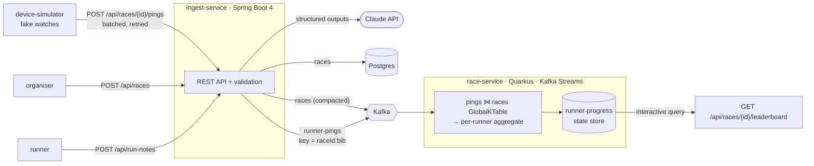

# splitstream

Live race tracking from running-watch GPS: an event-driven system on Kafka, built from two Java services.

Simulated watches stream GPS fixes in. A Spring Boot service validates them onto Kafka. A Quarkus Kafka Streams service turns them into live distance, pace, finish times and a leaderboard. Runners can also log training in plain English, and an LLM turns the note into a validated, structured run log.

> **Status:** work in progress. The streaming core is built and tested. See the [roadmap](#roadmap) for what's next.

## Architecture



| Piece | What it does |
|---|---|
| `ingest-service` | Races in Postgres (JPA, Flyway). Validates ping batches and publishes them with `acks=all`. Returns 503 + `Retry-After` if Kafka doesn't ack. Turns free-text run notes into validated run logs |
| `race-service` | Joins pings to their race, accumulates distance (haversine) and interpolates the finish crossing. Ignores duplicates and late pings. Serves the leaderboard from the local state store |
| `device-simulator` | A field of runners with different paces and fades on the Sea Point promenade, Cape Town. Buffers and retries like a real watch. JDK only |

## Design decisions

These are short ADRs in [`docs/adr`](docs/adr):

1. [Telemetry in Kafka, reference data in Postgres](docs/adr/0001-telemetry-in-kafka-reference-data-in-postgres.md)
2. [Spring Boot for the API, Quarkus for the streaming service](docs/adr/0002-quarkus-for-the-streaming-service.md)
3. [Ordering, duplicates and where the leaderboard state lives](docs/adr/0003-ordering-duplicates-and-state.md)
4. [Dual write on race creation (known gap)](docs/adr/0004-dual-write-on-race-creation.md)
5. [LLM output is untrusted input](docs/adr/0005-llm-output-is-untrusted-input.md)

## Run it

You need JDK 17+ and Docker.

```bash
docker compose up -d                                   # Postgres + Kafka (KRaft)

./mvnw -pl ingest-service spring-boot:run              # :8080, creates the topics
./mvnw -pl race-service quarkus:dev                    # :8081, in another terminal

./mvnw -pl device-simulator package
java -jar device-simulator/target/device-simulator.jar --runners=12 --speedup=20
```

The simulator prints a leaderboard URL. Refresh it and watch the field spread out:

```bash
curl -s localhost:8081/api/races/<raceId>/leaderboard
```

```json
[
  {"position": 1, "bib": "107", "distanceMeters": 5000, "elapsedSeconds": 1106, "pacePerKm": "3:41", "finished": true,  "finishedAt": "..."},
  {"position": 2, "bib": "103", "distanceMeters": 4718, "elapsedSeconds": 1140, "pacePerKm": "4:02", "finished": false, "finishedAt": null}
]
```

### Run notes

Needs an Anthropic API key (`export ANTHROPIC_API_KEY=...` before starting ingest-service). Everything else runs without one.

```bash
curl -s localhost:8080/api/run-notes -H 'Content-Type: application/json'   -d '{"note": "Easy 10k this morning, 58 min. Left knee got sore after about 7k."}'
```

```json
{
  "distanceKm": 10.0,
  "durationMinutes": 58,
  "type": "EASY",
  "perceivedEffort": 3,
  "niggles": [{"bodyPart": "knee", "side": "LEFT", "startedAtKm": 7.0, "severity": "MILD"}],
  "summary": "Easy 10 km in 58 minutes; left knee became sore around 7 km."
}
```

If a note doesn't give a number, it comes back as `null` instead of a guess. If the model's answer breaks a rule (a 900 km run, a niggle after the finish), the response is a 422 listing the problems. See [ADR 5](docs/adr/0005-llm-output-is-untrusted-input.md).

Swagger UI for ingest-service is at http://localhost:8080/swagger-ui.html.

## Tests

```bash
./mvnw verify
```

| Level | What | Needs Docker |
|---|---|---|
| Web slice | Validation, 404/422/503 mapping, one event per ping, checks on model output with the model mocked (`@WebMvcTest`) | No |
| Topology | The whole Kafka Streams topology in-process (`TopologyTestDriver`): distance, finish interpolation, duplicates, unknown races | No |
| Integration | Real Postgres and Kafka (Testcontainers). Asserts on the raw JSON contract on the wire | Yes (skipped without it) |
| Live eval | Run notes with known right answers against the real model | No, but needs `ANTHROPIC_API_KEY` (skipped without it, and in CI) |

CI runs all three on every push ([`.github/workflows/ci.yml`](.github/workflows/ci.yml)).

## Roadmap

- [x] **AI run notes:** turn free text ("easy 10k, left knee sore after 7") into a validated, structured run log with an LLM and JSON-schema output
- [ ] **Finish-time prediction:** a model trained on past races predicts each runner's finish from their first few kilometres
- [ ] Split events (`runner-splits` topic, every km) and a live-updating leaderboard over SSE
- [ ] Transactional outbox for race events ([ADR 4](docs/adr/0004-dual-write-on-race-creation.md))
- [ ] Container images and Kubernetes manifests. race-service as a GraalVM native image
- [ ] Elasticsearch for searching runners and results across races
- [ ] Multi-instance leaderboard queries ([ADR 3](docs/adr/0003-ordering-duplicates-and-state.md))

## Stack

Java 17 · Spring Boot 4.1 · Quarkus 3.40 · Claude API (structured outputs) · Kafka 4.3 (KRaft) · Kafka Streams · PostgreSQL 18 · Flyway · Testcontainers 2 · JUnit 5 · AssertJ · GitHub Actions
